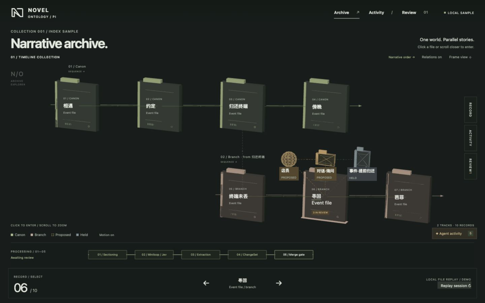
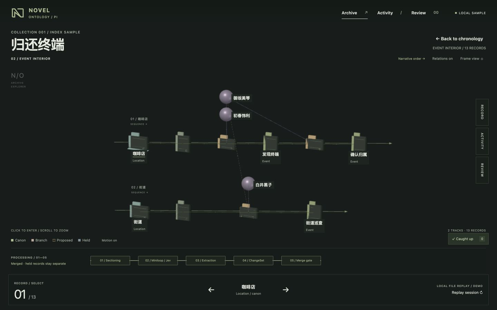

# Playground — narrative archive

The unified debug/testing UI for novel-ontology-pi: **one graph, many
cameras**. The timeline lanes, a big event's 3D interior, the live
decision stream and the merge-gate queue are all views over the same
ontology graph — the agent knits where it knits, the user's camera is
never stolen, and a shining activity tab guides you to the work.

The archive design takes its visual direction from
[Rhine Music Database](https://github.com/MikeQu223/Rhine-Music-Database):
charcoal surfaces, restrained olive accents, thin rules, and a spatial
collection of physical records. Characters use spheres, while chapter-level
big events and their event records use archive cards. Its geometry, mark, and CSS are original;
the app uses system fonts and does not load remote visual assets.

## Explore the archive

- Click a file in the scene or record index to enter its interior directly.
  Files without interior data zoom into place. Characters remain selectable
  spheres; chapter-level events and event records are cards.
- Scroll or pinch closer to a detailed overview file to enter it automatically
  when it occupies 68% of the usable scene height. Zoom out until the interior
  becomes small to return to the chronology automatically. Separate entry and
  exit thresholds prevent bouncing between views. Both transitions require a
  zoom gesture; initial framing and background processing cannot trigger them.
- The overview shows big events on the canon and branch timelines alongside
  live proposal ghosts, tethered to their parent file. Proposed records are
  translucent amber wireframes; held records are slate. They also appear in
  their event interior. Approval solidifies accepted records and leaves held
  records separate. Incoming proposals do not move the main timeline files.
- Focus the scene and use Left/Right to select a record, Enter to open,
  and Escape to return. Footer arrows provide the same selection controls.
- Timeline tracks are straight, directed rows. Overview branches align their
  first record with the explicit canon fork. Interior tracks follow connected
  story chains, such as separate locations or battles, on the same sequence
  axis. Positions use the read model's `chrono` key; they do not infer wall-clock
  simultaneity. Characters sit beside the event chain rather than bending it.
- **Relations** is on by default and draws directed ontology links alongside
  the straight chronological rails. Turn it off for a quieter timeline.
  Overview parent tethers come from each live record's `parent` field; links
  to hidden interior endpoints appear when that interior is open.
  **Frame view** fits current positions. Activity never
  reframes the scene automatically; the activity button is an explicit flight.
- **Record**, **Activity**, and **Review** toggle a translucent inspector over
  the fullscreen scene. Click the active side tab again or the close button
  to collapse it. The tab list supports Up/Down, Left/Right, and Home/End
  keyboard navigation.
- **Motion reduced** uses immediate camera changes. The initial preference
  follows the operating system and also disables processing animations.
- The React Flow processing strip stays visible alongside the 3D graph,
  including on mobile (scroll the strip horizontally). Active stages pulse
  and connecting edges animate while the sample agent is working. Gate
  review and merge completion stop the working animation. **Replay session**
  restarts the sample so you can watch ghosts arrive in place.

The 3D canvas fills the viewport, with transparent controls and collapsible
details overlaid on desktop and mobile. Major files retain their labels; other labels appear
for key records, hover, or selection, with collision suppression. Every
record remains available in the keyboard-accessible index.





This is a **local sample replay**. Review actions update the sample UI;
they do not approve or write real CLI ChangeSets. The real `novel watch`
SSE adapter and initial snapshot are still separate integration work;
see `docs/playground-events-watch.md` at the repository root.

The original interaction model is described in
`docs/system1/playground-frontend.html` in the repo root; this README
documents the current archive presentation.

## Run it

```bash
cd apps/playground
npm install
npm run dev        # http://localhost:5173
```

Requires **React 19** — Reagraph 4.32 bundles @react-three/fiber v9,
which crashes on React 18 internals ("reading 'S'" at reconciler
creation). The root CLI package is unaffected.

## Data: local files only

The app reads everything from local files under `public/db/novel/` —
a simulated novel bundle in the exact layout the CLI writes, plus the
playground read model and the session stream. No external APIs, no
CDN: even the graph's node labels are plain HTML projected from the
3D scene every frame, because Reagraph's built-in labels (troika /
drei Text) fetch font data from a CDN at runtime — and when that
fetch fails, the suspension takes the whole scene down with it.

| File | Role |
| --- | --- |
| `ontology/manifest.json`, `ontology/*.jsonl` | the simulated bundle (source of truth) |
| `view.json` | playground read model: positioned nodes/edges for lanes + interiors |
| `events.jsonl` | the PlaygroundEvent stream (`{"at": ms, "event": …}` per line) — the file `novel watch` will tail / serve over SSE |
| `changesets/cs_b0011.json` | the session's ChangeSet record |

`view.json` and `events.jsonl` are generated from the seed data in
`src/data/demoWorld.ts` + `src/events/demoSource.ts`:

```bash
node tools/gen-fixtures.mjs
```

## Single-file edition

```bash
npm run build && node tools/build-singlefile.mjs
```

Produces `playground-live.html` — the whole app plus the DB files
embedded, runnable fully offline from one file (handy for phone
testing).

## Contracts it codes against

- `PlaygroundEvent` sample stream (`src/types.ts`): `block.started`, `sectioned`, `verdict` (Jev),
  `proposal.added`, `changeset.pending` / `held` / `merged`,
  `graph.rebuilt`. Served by `FileEventSource` (`src/events/`). The native
  CLI event envelope differs; see the integration contract above.
- Ghost states: proposed (amber), held (slate), canon (kind colors).
  Held proposals stay held when the rest of the set merges.
- Notification policy: gate arrivals and holds mark the activity button
  immediately. Clicking it opens the review inspector at the work site.
  Agent activity never moves the camera on its own — framing happens
  on view/viewport changes and explicit user actions.
- Camera notes: `cameraMode="rotate"` — Reagraph's `"orbit"` is an
  auto-rotating showcase mode (20°/s), not mouse-orbit. Node
  positions are pinned via `fx/fy/fz` (v4.32 ignores a `position`
  field). Initial framing uses the chronological positions; explicit
  reframing uses the scene's current positions. The settling frame is
  cancelled when the user starts interacting with the scene.
